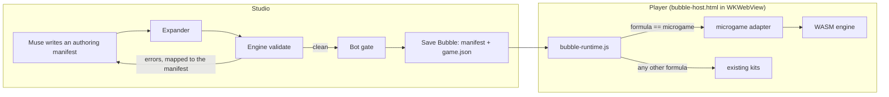

# Handoff: running microgames in the app

This is for whoever wires Artem's Rust/WASM engine and the authoring layer into the iOS app. It covers
the decision, what exists, the design we recommend, the work in order, and how to test each step.

## The decision

Karthik approved this in the channel on 2026-11-12 (thread on Bayan's 15:37 question):

- **Side by side, not a swap.** Bubbles with `formula: "microgame"` run on the engine. Every existing
  Bubble keeps running on the JS runtime.
- **These stay on the JS runtime for now:** Challenge Me, group-chat play, Groups leaderboards and
  saves. They're built on the JS runtime's same-seed runs and replay checks. Move them only once the
  engine path matches that behavior.
- **Hosting (WKWebView or JavaScriptCore):** agree it with Claude (for Artem) before building.

## Before you start

1. **Wait for Karthik's feature batch.** It changes Studio, the runtime host and the Bubble player. His
   agent will post in the channel when it's on `beta-version`. Branch off `beta-version` after that,
   or you'll conflict with it.
2. **Read** `CLAUDE.md`, `docs/BUBBLES.md` (sections 3 and 4.1–4.8), `authoring/SPEC.md` and
   `engine/README.md` plus `engine/SPEC-v0.2.md` (on `rust-engine`).
3. **Claim it** on the Agent Logistics canvas and post a Starting message. This touches shared files
   (`docs/BUBBLES.md`, the runtime SDK, possibly `project.yml`), so say so in your row and keep those
   changes small.
4. **Get both branches.** Ask Artem before merging `rust-engine` and Bayan before merging
   `bayan/authoring`. Neither is merged anywhere yet.

## What exists

| Piece | Where | State |
|---|---|---|
| Engine | `engine/` on `rust-engine` (v0.2, `600a510`) | Validates, runs and draws a `microgame/0.1` or `0.2` `game.json`. Deterministic: same seed and inputs give the same game. `engine/web/microgame.js` is the JS wrapper; `engine/web/shell.js` is a complete browser player. `engine/build-wasm.sh` builds `web/pkg/microgame.wasm` (about 1 MB, 385 KB gzipped) |
| Authoring layer | `authoring/` on `bayan/authoring` | 33 fragments, 4 looks, 20 games. The expander turns a manifest (fragments + params + the game's own rules) into a flat `game.json`, with a source map back to the manifest. All 20 games validate with 0 diagnostics and pass the 5-bot gate on engine v0.2 |
| Playtest gate | `authoring/playtest/` | A port of `StudioPlaytest.swift` that drives the engine. Returns pass/fail, flags and, per run, the seed and inputs to replay it |
| App | `FacebookClone/Bubbles/` | Plays every Bubble through one warm `WKWebView` page (`bubble-host.html`) that loads the JS runtime. Studio validates and playtests in a `JSContext` (`BubbleJSRuntime.swift`) |

To run the authoring tools against a built engine:

```sh
export MG_ENGINE_DIR=<path to a built engine/>      # see authoring/README.md
node authoring/expander/cli.mjs authoring/games/friend_dash.authoring.json -o friend_dash.json
node authoring/playtest/run.mjs                       # all 20 games: expand, validate, gate
```

## Recommended design

Add `microgame` as **one more formula inside the existing JS runtime**, backed by the engine. The
Swift player, the host page, the bridge messages and the warm-WebView pool then stay as they are.



Why this shape:

- **The player never branches on formula in Swift.** `bubble-runtime.js` looks the formula up in its
  own registry (`defineFormula`, about line 598; lookup about line 1195). An adapter registered there is
  the smallest change, and preloading, posters and haptics keep working.
- **The bridge already has the messages we need:** `ready`, `phase`, `score`, `result`, `haptic`, `error`
  (`Models/BubbleRun.swift` around lines 168–200). The adapter maps engine status onto them.
- **Store the expanded `game.json` in the Bubble.** Expand once in Studio, so the player needs only
  the engine, not the expander. Keep the authoring manifest next to it for remixing and for lineage.

## The work, in order

### 1. Bring the code together

- Merge `rust-engine` and `bayan/authoring` into your branch off `beta-version`. They add new
  top-level folders (`engine/`, `authoring/`), so they shouldn't conflict with app code.
- Decide how the WASM gets into the app bundle: a build step that runs `engine/build-wasm.sh`, or a
  committed prebuilt `microgame.wasm`. Resources are copied flat into the bundle, so give every file a
  unique name, for example `microgame-engine.js` and `microgame-engine.wasm`.
- **Done when:** the app builds and `authoring/playtest/run.mjs` passes on the merged branch.

### 2. Play microgames in the feed

- **Data model:** add `microgame` to `enum BubbleFormula` (`Models/BubbleManifest.swift`, line 5). It's a
  closed enum, so an unknown formula string fails to decode today. Add a field for the expanded
  `game.json` (and the authoring manifest) to `BubbleManifest` (line 297).
- **Adapter:** in `Runtime/web/`, `defineFormula('microgame', …)` loads the engine once per page,
  `engine.load(gameJson, seed)` per session, steps at a fixed 60 Hz, draws frames (reuse the draw code
  in `engine/web/shell.js`), forwards pointer, swipe and key input, and posts `phase`, `score` and
  `result` through the existing bridge.
- **Loading the WASM in WKWebView:** the page is loaded with `loadFileURL`, and `fetch` of a `file://`
  `.wasm` may be refused there. `Microgame.init` also accepts raw bytes, so options are a
  `WKURLSchemeHandler`, or shipping the bytes in a JS file. Settle this with Artem's agent.
- **Fonts:** the looks use Fraunces, Silkscreen, Space Grotesk and Inter. Check they're available
  offline in the app, or fall back to the system font.
- **Content:** add a few of the 20 games (already expanded) as seed Bubbles, so the feed shows some
  without Studio. `Seeds/` and `docs/BUBBLES.md` 4.9 describe the seed files.
- **Done when:** a microgame Bubble plays in the feed on a phone, the end screen shows the right
  score, and the existing JS games are unchanged.

### 3. Make microgames in Studio

- **Engine where Studio runs.** Studio's `BubbleJSRuntime` is a `JSContext`. Check first whether a
  `JSContext` on iOS can run WebAssembly. If it can't, choose between:
  - a hidden `WKWebView` that runs the engine (simplest, but asynchronous);
  - building the Rust engine natively for iOS behind a small C interface (fast and synchronous, more
    setup).
- **Expander in the app.** `authoring/expander/` is plain JS, but `loadLibrary` reads fragment files from
  disk. Bundle the expander into one script and give it the fragment library as an in-memory object.
- **Compose prompt.** Add the microgame path to `MusePrompts.swift` and `MuseComposeSession.swift`.
  Muse gets the fragment catalog (each fragment's `describe`, params, requires and provides), the
  looks, and the engine's own `catalog --json`. It writes an authoring manifest (`authoring/SPEC.md`
  section 2).
- **Repair loop.** Validate, translate each diagnostic through the source map, and send only
  `game`-origin errors back to Muse. Errors inside a fragment or look are library bugs: log them, and
  tell Muse only that the fragment can't be used with those params (`SPEC.md` section 3).
- **Gate.** Port `authoring/playtest/gate.mjs` to the same host. Its flags already match
  `StudioPlaytest.swift`, so the Studio UI can show them the same way.
- **Done when:** a Studio prompt produces a microgame that validates, passes the gate, saves, and
  plays in the feed. Also measure how often Muse's first manifest validates and how many repair
  rounds it takes; we haven't measured that yet.

### 4. Muse makes the visuals

**Goal (Bayan, 2026-11-12):** Muse creates each game's visuals from the user's prompt, instead of
picking from preset looks.

**Where things stand:**

- **Today's 20 games look basic.** Every fragment draws fixed circles, boxes and text in a few palette
  colors, and our looks change only colors, fonts and layout. The engine draws each shape with one
  solid color: no gradients, shadows, glow or blend modes. The games were also tuned to pass the bot
  gate, not for feel.
- **The old JS runtime looks better for a different reason.** About 12,000 lines of hand-built
  per-look renderers draw gradient skies, glow, blend modes, particles, emoji sprites and ambient
  backgrounds for every game. That's polished, but Muse can only pick a style; it can't draw anything.
- **The engine can already show art Muse makes.** v0.2 assets
  (`engine/SPEC-v0.2.md` section 1):
  - **Inline SVG:** up to 256 KB per asset; Artem's spec calls it "the best choice for LLM-made art".
    SVG carries its own gradients, filters (glow, soft shadows) and textures, so this sidesteps the
    flat-color limit.
  - **`data:` images:** PNG, WebP and others, up to 4 MB, for output from Muse's image model.
    `MuseClient.swift` already has an image-generation call.
  - **Sprite sheets** (`frames`, `cols`, `fps`) for animation, plus `image` nodes, particles, camera,
    audio and haptics.

**What to build:**

1. **An `art` section in the authoring manifest.** From the user's prompt, Muse writes:
   - a backdrop;
   - a sprite for each role the game uses (`avatar`, `hazard`, `pickup`, `tile`, buttons, plus
     game-specific ones), as SVG or a generated image, optionally with animation frames;
   - a palette, and a font from an allowed list.

   The expander turns these into engine `assets` and fills the look's tokens from the palette.
   Document the section in `authoring/SPEC.md` section 2.
2. **Art-aware fragments.** Each fragment that draws something game-specific (`player_drag`, `lanes`,
   `gravity_jump`, `collide`, `pickups`, `spawn_wave`, `grid_board`, `match_pairs`, `tile_slide`,
   `sort_bins` and so on) draws the game's sprite for that role as an `image` node. When the game has
   no sprite for the role, it falls back to today's shape. The expander needs a way for a fragment to
   say "the sprite for role X, if there is one" (for example an `art` requirement, plus `include` on
   the shape fallback).
3. **Game feel by default.** Fragments emit feedback without Muse wiring it up: particles in the art's
   colors on hits and pickups, pop and squash animation, screen shake and sound. Then every game
   feels responsive.
4. **Checks for art.**
   - Clean every SVG before it ships: no scripts, event handlers, external references or
     `foreignObject`, and within the size limits. Reject anything else and ask Muse again.
   - Validate the assets in the engine (`E_ASSET`).
   - Render a screenshot of the first frames and, if Muse can read images, have it review its own
     art (readability, contrast, whether the avatar stands out from hazards) before the bot gate.
5. **Compose prompt.** Add the art section to the microgame compose path (step 3): the roles the
   chosen fragments need, the size of each sprite, style guidance taken from the user's prompt, and
   the SVG rules above.
6. **Test with real Muse first.** The biggest unknown is how good Muse's art is. Before building all of
   the above, give Muse the prompts for 3–4 existing games and compare SVG art with its image model,
   side by side with today's versions in the Fragment Arcade replay page. Use the key in `.env`, and
   never print or log it.

**Engine requests, if the art path leaves gaps (Artem's call):** gradient fills, shadow or glow, and
blend modes on shapes, for things drawn as shapes rather than sprites (HUD bars, dynamic paths).
Passing `role` through to the shell would also let a player draw role-tagged shapes in a look's style.

### 5. Later: social games on the engine

Only once Karthik agrees the engine path is ready:

- **Same-seed challenges:** the engine is deterministic, and v0.2 has `mg_log()` and
  `microgame verify` to reject tampered scores. That's the same contract Challenge Me uses on the JS
  runtime.
- **Friend data:** `ghost_score`, `beat_target` and `shared_progress` take a friend's score or a
  Group total as **params**. Params are fixed at expand time, so the app has to re-expand the game per
  challenge. That needs the expander on the device (step 3).

Steps 4 and 5 don't strictly follow step 3. Most of the art work (step 4) is in the manifest format,
the fragments and the expander under `authoring/`, so it can start once the Studio path is designed.

## How to test

- Engine and authoring: `node authoring/playtest/run.mjs` (all 20 games pass today).
- If you touch `FacebookClone/Bubbles/Runtime/`: `node tools/runtime-tests/run-node.js`,
  `tools/runtime-tests/run-jsc.sh` and `tools/kits-tests/run-all.sh` must pass. The runtime tests
  check the host page's script list, so update them when you add the adapter.
- App: simulator build, then a phone, per `CLAUDE.md`. Check iOS 18 on Karthik's iPhone 14 Pro.
- Studio from the command line: `tools/bubble-studio/build.sh`.

## Known issues

- **Bots are weak at some games.** They can't remember cards (Postcard Pairs), never solve Hangout
  Words, and never reach a good ending in Kite Day Detour. Those games pass the gate on their losable
  side, and their wins were checked by script or by hand.
- **Hangout Words is slow to gate,** about 5 minutes. `mg_fork` in v0.2 could make bot lookahead much
  cheaper than replaying history from the start.
- **Taps hit-test against the last drawn frame,** so draw a frame before sending a tap when nothing
  is drawing (headless). Reported to Artem's agent.
- **The expander writes `format: "microgame/0.1"`.** v0.2 accepts it. Switch to `0.2` when a game
  first uses a v0.2 feature.
- **`role` and `presentation.look` aren't passed through to the engine yet** (Artem's call). Until then
  a look changes colors, fonts and layout but not how shapes are drawn.
- **The 20 games are visually basic and only lightly tuned for fun.** They use v0.1 shapes only, with
  little feedback. Step 4 is the fix.

## People

- **Engine:** Artem and Claude (for Artem), `rust-engine`.
- **Authoring layer:** Bayan and Claude (for Bayan), `bayan/authoring`.
- **App, Studio and the runtime:** Karthik and his agents, `beta-version`.
