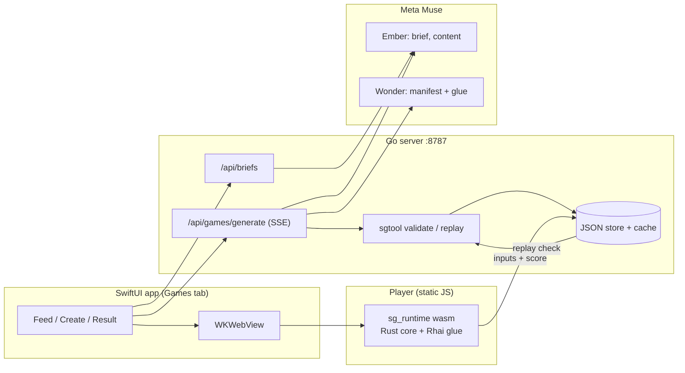

# Scroll Games: project page answers

## Name

Scroll Games

## Tagline

Describe a game, play it in seconds, challenge your friends.

## Problem

People spend hours scrolling and almost none of them make anything. Making even a tiny game needs design, code and content, and the content that matters most (your friends, your trips, your inside jokes) is the one thing a generic game template cannot supply. Social feeds are full of things to watch and thin on things to play together.

## What it does

A Games tab inside a Facebook-style iOS app.

- Create: type a sentence, optionally pick photos from a group (off by default), review an editable brief, watch the build, preview, publish. Live build is about 5 seconds.
- Play: a photo quiz with a countdown, timer, streaks, time bonus and generated rules such as "final round is worth double". It runs offline in the WebView once loaded.
- Challenge: finish a game and send a "Beat them?" challenge to friends. The link `/c/<id>` also opens in a plain browser at the same seed.
- Feed: challenges addressed to you first, then your own recent items, friends, followed creators, discover.
- Scores are verified: the server replays your recorded inputs and compares.

- Daily game: one game per UTC day, same seed for everyone, from `GET /api/daily`. The first verified play per day counts, later ones are practice. A pinned "Today's daily" card tops the Games tab with a streak counter.
- Demo photos: 12 photos generated with muse-image-1.0 from the synthetic captions, no identifiable faces, served from `/media/*`.
- Follows are saved on the server (`POST`/`DELETE /api/users/{id}/follow`).

## How it is built

- Runtime: pure-Rust core `sg_runtime`, fixed 60 Hz seeded simulation, compiled to wasm (391 KB gzipped). The JS player only renders a JSON view model. The same crate builds the native `sgtool` CLI, so validation and replay use identical logic.
- Glue: Rhai scripts written by Wonder, sandboxed (50,000 operations per event, depth 32, no eval, no imports).
- Server: Go standard library, JSON-file storage, SSE stage events, spend cap, disk cache of Muse results.
- A game is data: a manifest of concepts (179 in the catalog, 20 implemented) plus content plus glue.

## How Meta AI is used, and why it is essential

- Ember (fast): writes the editable brief in about 1.2 s and the quiz content (prompts, four choices, clue) from the selected photo captions, about 2.2 s.
- Wonder (planner): plans the manifest and writes the glue script in one structured call, about 5.0 s, in parallel with Ember. Its plans passed validation on the first try in 9 of 9 live runs.
- Why it is essential: the value is content built from people's own material, and mechanics nobody pre-built. Questions like "Where was this sunset?" need the captions. A rule like "double the last round" is new behavior, delivered as a script against a small event API instead of new app code. Without Muse the engine and template games still run, but nobody could make a game about their friends' photos in under a minute.
- Safe by construction: Muse output is only data and sandboxed scripts, validated by the Rust core before anyone plays it. Failure falls back to a repair call, then a pre-baked template.

## Challenges

- Latency: first version took 16.5 s from prompt to game. Fixes: minimal reasoning effort, Ember for the brief, Wonder and Ember in parallel, and speculative generation that starts building when the brief is returned. Brief plus generate is now 6.6 s p50; generating after review costs 13 ms.
- Trusting AI-written logic: solved by making games data plus a tiny sandboxed scripting API, and a validator that dry-runs every glue entry.
- Fair scores: runtime is deterministic with recorded inputs, so the server can replay and verify.
- One engine, three surfaces: iOS WebView, plain browser and server CLI must agree exactly, so they share one Rust crate.

## Accomplishments

- 5.2 s live in-app build at about $0.027 per game.
- Verified scores by server replay; browser challenge links at the same seed.
- 391 KB gzipped wasm, 20 implemented concepts in a 179-concept catalog.
- End-to-end scripts (`scroll-games/scripts/e2e-test-game.mjs`, `browser-play-check.mjs`) that run the whole path.

## What's next

- Implement more of the catalog (stub concepts), more templates beyond quiz, Compose and Free creator levels in the UI.
- Real moderation before publish, real accounts, consent flows for photos tagged with other people, real-device testing.
- Hosted server with per-user quotas.

## Built with

Swift/SwiftUI, WKWebView, Rust, wasm-bindgen and wasm-pack, Rhai, Go (net/http), Server-Sent Events, Meta Muse (Wonder, Ember), JSON Schema.
